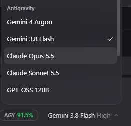
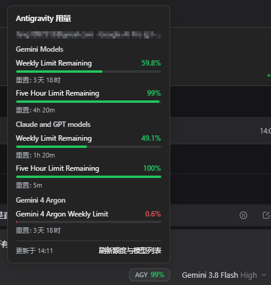
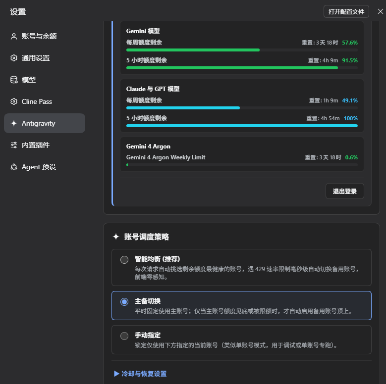

# dsh-gemini-pool（本地增强版）

把 **Antigravity（Google Cloud Code Assist）** 接入 [DeepSeek Harness](https://github.com/deepseek-ai) 的模型提供者插件：
OAuth 登录、多账号池、**实时模型目录**（含 Gemini 4 Argon / Claude Opus 5.5）、聊天框额度显示，以及一套与官方 CLI 对齐的请求行为。

> 这是 [qikairo7/dsh-gemini-pool](https://github.com/qikairo7/dsh-gemini-pool) 的 **fork 增强分支**（基于上游 `0.8.2`）。
> 与上游的关系：保留其架构与 UI，替换了模型目录、请求体/请求头、错误处理与额度展示。







---

## 功能

### 模型目录：从端点实时拉取，不再写死

- 后端 `fetchAvailableModels` 返回什么就显示什么；带官方 CLI 身份标识时能拿到 **26 个模型**（不含时为 20 个，且生成会被 429）。
- 变体自动合并：`gemini-4-argon-{low,medium,high}` 合并为一个「Gemini 4 Argon」条目，带 `runtimeIds` / `modelEnums` / `thinkingLevels`。
- 新模型自动出现在列表里，无需改代码；设置页「刷新额度与模型列表」可手动触发。

### 聊天框额度徽标

模型选择器左侧的 `AGY xx%`：显示本周剩余额度，点开看 Gemini / Claude & GPT / Gemini 4 Argon 三个桶的周额度与 5 小时额度及重置时间。

### 请求行为对齐官方 CLI

抓包比对后逐项对齐（详见 [docs/GENERATE-BODY-DIFF.md](docs/GENERATE-BODY-DIFF.md)）：

| 项 | 说明 |
|---|---|
| User-Agent | `antigravity/cli/1.5.1 (aidev_client; os_type=…; arch=…; cl=…; auth_method=consumer)` |
| 出站节奏 | 全局 1 req/s、严格串行，不再并行打双端点 |
| 端点 | 只打 `daily-cloudcode-pa.googleapis.com`，失败串行回退 |
| 请求头 | 仅 Authorization / Content-Type / Accept / User-Agent |
| 生成体 | `userAgent`、`requestId: agent/<cascade>/<ms>/<trajectory>/1`、`labels`（含 `model_enum`）、`sessionId`（int64 派生）、`thinkingConfig.includeThoughts` |
| 工具声明 | `tools[].parameters` 使用大写 Gemini Schema（与 CLI 同构） |

### 修掉的两个坑

- **不再静默降级**：选了 `Gemini 3.8 Flash` 不会偷偷换成 3.7（3.7 是 Enterprise 专属，会 404 并把真实错误藏起来）。出错时消息里带 `model=` / `tried=[id:status]` / 首次失败原文。
- **前言文本折叠**：Gemini 每步输出 "Let me read the file…" 这类普通正文会把会话正文刷满；现在这类「紧跟工具调用的正文」会按 reasoning 上报，折叠进思考预览。回放给模型的历史**仍是原文**（`ANTIGRAVITY_PREAMBLE_AS_REASONING=0` 可关闭）。

### 其它

- 多账号池：智能均衡 / 主备切换 / 手动指定三种调度，429 毫秒级切号；
- 图像生成（`inlineData`）与图像输入（vision bridge）；
- `claude-*` / `gpt-oss-*` 走各自的旧 schema 分支，不受 Gemini 调整影响。

---

## 安装

插件以 DSH bundle 形式安装：把依赖写进某个 profile 的 `package.json`，并把 `dsh-gemini-pool` 加进 `dsh.profile.bundles`。

### 方式 1：直接装这个仓库

```jsonc
// ~/.dsh/profiles/<profile>/package.json
{
  "dependencies": {
    "dsh-gemini-pool": "github:CyanAutumn/dsh-gemini-pool"
  },
  "dsh": {
    "profile": {
      "bundles": ["@deepseek-ai/dsh-base", "@deepseek-ai/dsh-web-app", "dsh-gemini-pool"]
    }
  }
}
```

```powershell
cd $env:USERPROFILE\.dsh\profiles\<profile>
pnpm install
# 重启 DeepSeek Harness
```

### 方式 2：本地目录 / tarball（离线）

```jsonc
"dsh-gemini-pool": "file:C:/path/to/dsh-gemini-pool"
// 或
"dsh-gemini-pool": "file:C:/path/to/dsh-gemini-pool-0.8.2-patch.4.tgz"
```

### 首次使用

1. 设置 → **Antigravity** → 登录（浏览器 OAuth）；
2. 模型列表 → **Antigravity** 分组 → 选择模型（如 `Gemini 3.8 Flash`、`Gemini 4 Argon`）；
3. 聊天输入框左下角出现 `AGY xx%` 即额度徽标生效；
4. 模型/额度不对时，点设置页的「刷新额度与模型列表」。

---

## 环境变量

| 变量 | 默认 | 说明 |
|---|---|---|
| `ANTIGRAVITY_USER_AGENT` | 官方 CLI UA | 覆盖请求 UA（不建议改） |
| `ANTIGRAVITY_CLI_VERSION` | `1.5.1` | UA 中的 CLI 版本 |
| `ANTIGRAVITY_CLI_BUILD` | `1014269460` | UA 中的 `cl=` 构建号 |
| `ANTIGRAVITY_BASE_URL` | `https://cloudcode-pa.googleapis.com` | 备用端点 |
| `ANTIGRAVITY_PROJECT_ID` | 跟随 `loadCodeAssist` | 指定 GCP 项目 |
| `ANTIGRAVITY_PREAMBLE_AS_REASONING` | `1` | 工具调用前的正文是否按 reasoning 上报；`0` 关闭 |
| `ANTIGRAVITY_RUNTIME_MODEL` | 自动 | 强制某个 runtime 模型（调试用） |
| `ANTIGRAVITY_VISION_ENABLED` | 自动 | 关闭图像输入桥 |

---

## 与上游差异

完整列表见 [LOCAL-PATCH.md](LOCAL-PATCH.md)，逆向与验证材料见：

- [docs/REVERSE-AGY.md](docs/REVERSE-AGY.md) —— 对 Antigravity CLI / 桌面版的行为逆向
- [docs/GENERATE-BODY-DIFF.md](docs/GENERATE-BODY-DIFF.md) —— 生成请求体逐字段对照
- [docs/RISK-AND-PARITY.md](docs/RISK-AND-PARITY.md) —— 请求画像与风控考量

## 自检

```bash
node test/catalog-test.mjs        # 实时目录 → 可选模型 的合并逻辑
node test/tool-schema-test.mjs    # JSON Schema → Gemini Schema（CLI 同构）
node test/preamble-test.mjs       # 前言文本归类
node test/usage-pill-test.mjs     # 额度徽标注册与渲染
```

## 已知限制

- 依赖“官方客户端身份”这一事实；Google 调整策略时可能失效，届时需要重新逆向；
- 模型目录与额度完全以端点返回为准；
- 需要 Cloud Code Assist 可用账号（Google AI Pro 等）；
- 仅覆盖 Gemini / Claude / GPT-OSS 三类模型，`chat_*`、`tab_*` 等服务型模型不会出现在列表中。

## 许可

MIT，见 [LICENSE](LICENSE)。上游版权归 [qikairo7](https://github.com/qikairo7/dsh-gemini-pool) 所有，本 fork 的修改遵循同一许可。

---

## English

A DeepSeek Harness provider plugin for Antigravity (Google Cloud Code Assist): OAuth login, account pool, **live model catalog** (including Gemini 4 Argon, Claude Opus 5.5), and an `AGY %` quota pill next to the composer model picker.

Forked from [qikairo7/dsh-gemini-pool](https://github.com/qikairo7/dsh-gemini-pool) `0.8.2`, with request parity to the official Antigravity CLI, a live catalog instead of a hardcoded list, no silent model downgrade, and preamble text folded into reasoning.

Install: add `"dsh-gemini-pool": "github:CyanAutumn/dsh-gemini-pool"` to a profile's dependencies and `"dsh-gemini-pool"` to `dsh.profile.bundles`, then `pnpm install` and restart. See the screenshots above and `LOCAL-PATCH.md` for the change list.
